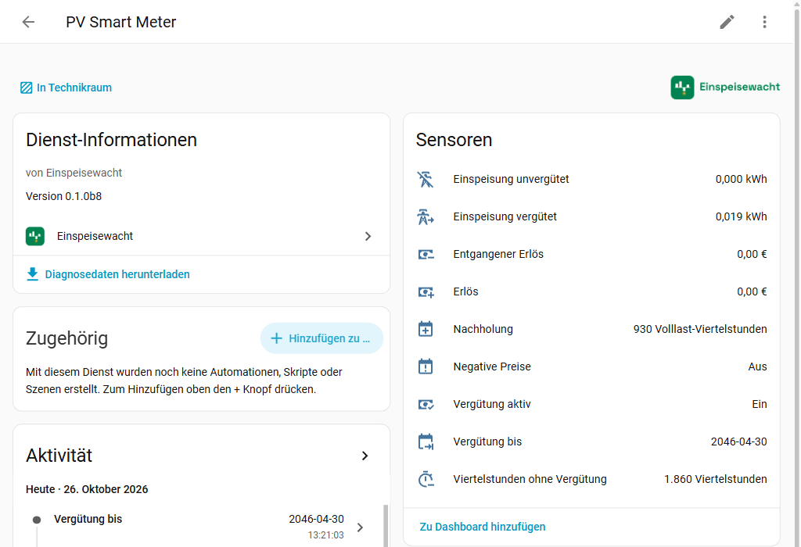
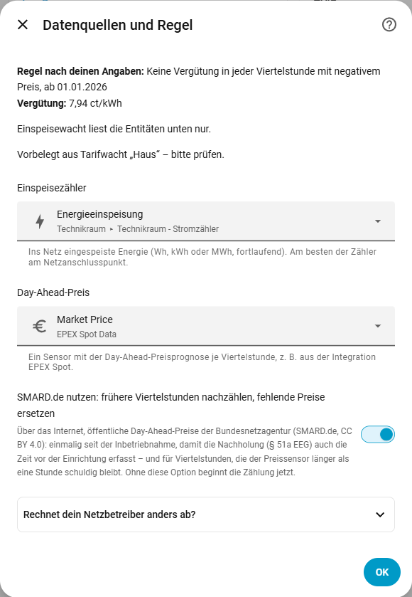
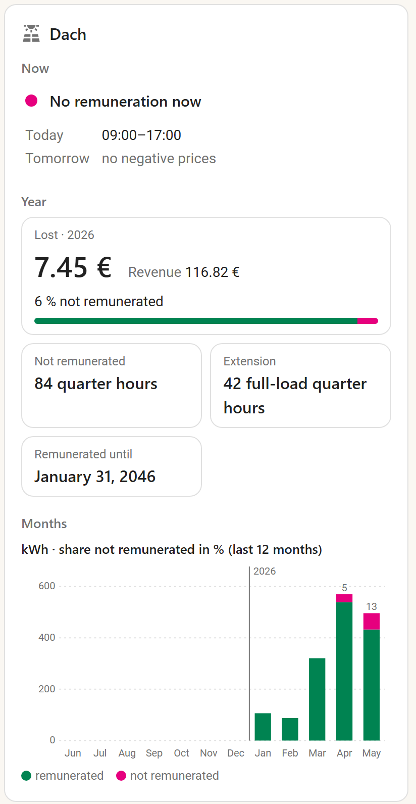
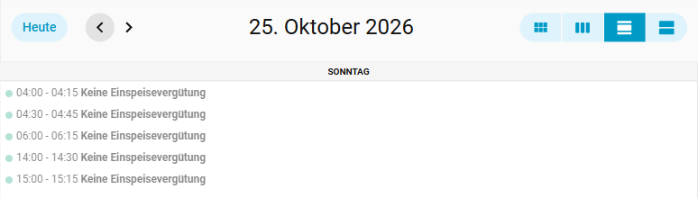
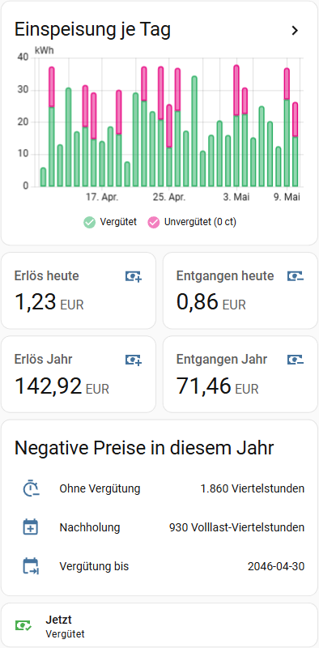

<picture>
  <source media="(prefers-color-scheme: dark)" srcset="https://raw.githubusercontent.com/einspeisewacht/integration/main/assets/github/readme-header-dark@2x.png">
  
</picture>

[](https://hacs.xyz/)
[](https://github.com/einspeisewacht/integration/releases)
[](https://github.com/einspeisewacht/integration/actions/workflows/ci.yml)
[](LICENSE)
[](https://einspeisewacht.github.io/integration/?lang=en)

🇩🇪 [Deutsch](https://github.com/einspeisewacht/integration/blob/main/README.md) · 🇬🇧 **English**

> ℹ️ **EEG amendment 2027:** It is still in parliament; any changes for existing plants will follow in an update.

**How much of your PV feed-in goes unpaid because of negative electricity prices?** Under Germany's Solarspitzengesetz, new PV plants lose their feed-in tariff in every quarter hour with a negative day-ahead price. Einspeisewacht tracks this in Home Assistant, quarter hour by quarter hour, with the price of exactly that quarter hour – and shows what it costs you and how much remuneration time is added at the end in return.

**Try it without installing:** the [demo](https://einspeisewacht.github.io/integration/?lang=en) shows the card, calendar, day-before notice, device and report for a plant with and one without a smart meter gateway – with made-up yields and prices, but computed by the integration's own code.

> **Not legal or billing advice.** The values are a guide. What counts is your grid operator's statement – it uses its meter's readings, Home Assistant usually inverter or optical-reader values.

The integration's UI is available in German and English and follows your Home Assistant language. It is built for German law (EEG) and the German-Luxembourg bidding zone.

## Contents

- [What Einspeisewacht does](#what-einspeisewacht-does) · [Which rule applies](#which-rule-applies--51-eeg) · [What Einspeisewacht does not do](#what-einspeisewacht-does-not-do)
- **Getting started:** [Requirements](#requirements) · [Installation](#installation) · [Setup](#setup)
- **Using it:** [Entities](#entities) · [Card](#card) · [Report for a period](#report-for-a-period) · [Import statistics](#import-statistics) · [Recalculate statistics](#recalculate-statistics)
- **[Examples](#examples):** [Card with built-in cards](#dashboard-card-with-daily-and-yearly-values)
- **More:** [Privacy](#privacy) · [Troubleshooting](#troubleshooting) · [Removal](#removal) · [Reporting issues](#reporting-issues) · [Sister integrations](#sister-integrations) · [License and sources](#license-and-sources)

## What Einspeisewacht does

- **Feed-in remunerated / not remunerated** (kWh) and **revenue / lost revenue** (€), with long-term statistics for day, month and year.
- **Quarter hours without remuneration** in the current year and the resulting **extension** under § 51a EEG: full-load quarter hours and the date your remuneration then runs until.
- **Remunerated**: binary sensor for automations – charge the battery, the car, or curtail.
- **Own dashboard card** with remuneration now, the windows today and tomorrow, the year and the last twelve months, no extra cards from HACS.
- **Calendar "Negative prices"** with the windows without remuneration – today and, once the day-ahead forecast is out (usually around 1 pm), tomorrow.
- **Action "Report"** for any period, by month – also for the time before setup, as far back as your meter's statistics reach.
- Derives the **applicable rule** from commissioning date, capacity and smart meter, with a manual override if your grid operator settles differently.
- **Exact at quarter-hour boundaries:** each meter delta is split over the quarter hours by time, each with its own price. A price of exactly 0 is not negative.
- **Robust:** ignores meter resets and implausible jumps, survives restarts, handles daylight saving changes (92 or 100 quarter hours).



## Which rule applies (§ 51 EEG)

| Commissioned | Installed capacity | No remuneration when … |
|---|---|---|
| from 25 Feb 2025 | 100 kW and more | every quarter hour with a negative day-ahead price |
| from 25 Feb 2025 | 2 to below 100 kW | as above, but only from 1 January of the year **after** a smart metering system (iMSys) was installed |
| from 25 Feb 2025 | below 2 kW | not affected |
| 2016 to 24 Feb 2025 | 400 or 500 kW and more | consecutive negative hours – not implemented (see below) |
| otherwise | | not affected |

An iMSys is a smart meter **gateway** installed by the metering point operator; a digital meter without gateway does not count. While the rule does not apply to your plant yet, Einspeisewacht adds sensors showing what you would have lost.

**A fixed feed-in tariff only exists up to 100 kW** (§ 21 EEG). Larger plants sell directly; negative prices cost them the market premium, not a fixed rate. Einspeisewacht counts energy and quarter hours correctly for them, but revenue and lost revenue are only a rough guide. The hour-block rules of older large plants therefore never affect a plant with a fixed tariff and are not implemented.

Sources and details (German): [docs/ENTWICKLUNG.md](docs/ENTWICKLUNG.md), section 2.

## Requirements

- Home Assistant 2026.3 or newer.
- A **feed-in meter**: cumulative energy sensor (Wh, kWh or MWh, `state_class` `total` or `total_increasing`) – ideally the meter at the grid connection point.
- A **price sensor** with a day-ahead forecast per quarter hour, e.g. from the [EPEX Spot](https://github.com/mampfes/ha_epex_spot) integration (source SMARD.de, market DE-LU). The `data` attribute of EPEX Spot is tested. Without a forecast attribute the current state counts as the price of the running quarter hour – prices are then missing for times Home Assistant was off, and if the sensor updates only minutes after the quarter-hour boundary, the old value applies until then.

## Installation

**One click:** [](https://my.home-assistant.io/redirect/hacs_repository/?owner=einspeisewacht&repository=integration&category=integration) → install, restart Home Assistant → [](https://my.home-assistant.io/redirect/config_flow_start/?domain=einspeisewacht)

Or by hand:

1. *Settings → Marketplace → Browse*, search for Einspeisewacht and install it (before Home Assistant 2026.11: search for it in HACS and download it). Restart Home Assistant.
2. *Settings → Devices & services → Add integration → Einspeisewacht*.

Note: the old HACS dashboard (before Home Assistant 2026.11) does not show the icon ([HACS issue #5171](https://github.com/hacs/integration/issues/5171)); the Marketplace and the settings do.

## Setup

Three steps; what few people need is collapsed.

1. **Plant:** name, commissioning date, installed capacity (kWp), whether an iMSys is installed and since when.
2. **Remuneration:** the rate from your grid operator's statement in ct/kWh (after the 0.4 ct deduction). Plants above 10 kWp with several rates open "Several rates by capacity band" and then enter the rate per band; Einspeisewacht forms the blended rate (§ 23c EEG).
3. **Data sources and rule:** on top the rule that follows from your details, when it starts and the rate. Below the feed-in meter and the price sensor – if you have set up [Tarifwacht](https://github.com/tarifwacht/integration), Einspeisewacht proposes both from there – and the option **Use SMARD.de**: it counts earlier negative quarter hours so the extension covers the time before setup too, and stands in when the price sensor fails (public price data, see [Privacy](#privacy)). If your grid operator settles differently, override the rule under "Does your grid operator settle differently?" ("every negative quarter hour from …" or "not affected").



Several plants or meters: one entry each. To change: *Einspeisewacht → entry → ⋮ → Reconfigure*. It starts with a short overview – plant, rate, which rule applies today, meter, price, SMARD.de – and below it what is missing and what that costs (e.g. "Feed-in meter not found – nothing is booked until it is back").

What a change means for the time before it:

- **Rate** (also tiers, capacity, full/partial feed-in): applies retroactively from setup – revenue and lost revenue are recalculated from the booked kWh. The long-term statistics of past hours (statistics graphs, values per day and month), [imported](#import-statistics) ones included, keep the old rate, though; Home Assistant books the whole difference into the hour of the change. *Repairs* therefore shows "Statistics with the old rate" – [Recalculate statistics](#recalculate-statistics) brings them to the new rate.
- **Rule** (commissioning, capacity, smart meter date, override): quarter hours without remuneration, extension, "Remunerated until" and the [report](#report-for-a-period) follow the new rule at once, retroactively too. The totals "Feed-in remunerated/not remunerated", "Revenue" and "Lost revenue" keep their split for the time before the change, though: Home Assistant would take a falling kWh total for a meter replacement and distort the statistics. The report gives the values under the new rule. If the change affects negative quarter hours already booked, *Settings → Repairs* shows "Totals partly follow the previous rule" with the date of the change and the number of quarter hours affected. It disappears if the rule is changed back; otherwise you can ignore it.
- **Feed-in meter:** the new meter starts from its own baseline; feed-in between the old meter's last reading and the new one's first is not booked.

If you rename the feed-in meter or the price sensor in Home Assistant (new entity ID), Einspeisewacht follows by itself – no reconfiguration, nothing lost.

## Entities

| Entity | Type | Meaning |
|---|---|---|
| Feed-in remunerated | kWh | grid feed-in in remunerated quarter hours, since setup |
| Feed-in not remunerated | kWh | grid feed-in in quarter hours without remuneration |
| Revenue | € | remunerated feed-in × rate |
| Lost revenue | € | unremunerated feed-in × rate |
| Quarter hours without remuneration | count | current calendar year, with or without feed-in (counts for § 51a); attribute `years` |
| Extension | full-load quarter hours | quarter hours × 0.5, rounded up; attribute `months` with the extension months |
| Remunerated until | date | end of remuneration including the extension |
| Remunerated | paid/unpaid | whether the running quarter hour is remunerated; unknown without a price |
| Negative prices | calendar | windows with a negative price |
| Rule | diagnostic | the rule applied, attributes `applies_from`, `applies_today` (whether the rule applies today – `false` e.g. before 1 January after the iMSys installation) and `rate_ct_per_kwh` |
| Recalculate statistics | button (configuration) | recalculates the statistics of revenue and lost revenue with the current rate, see [Recalculate statistics](#recalculate-statistics) |
| Report for a bug report | button (diagnostic) | shows a short report to copy into an issue, see [Reporting issues](#reporting-issues) |

While the rule does not apply yet (e.g. no iMSys), "… if the rule applied" sensors are added and the extension sensors are left out.

## Card

Einspeisewacht brings its own card, no extra cards from HACS needed: *Edit dashboard → Add card* and search for "Einspeisewacht". Einspeisewacht adds the dashboard resource itself (*Settings → Dashboards → ⋮ → Resources*, removed again with the last entry; with resources in YAML mode Home Assistant loads the card directly instead).



- **Now:** whether the current quarter hour is remunerated, and the windows with a negative price today and tomorrow – tomorrow once the day-ahead prices are out (usually from about 1 pm).
- **Year:** the calendar year – lost revenue large, revenue and the share not remunerated beside it, below quarter hours without remuneration, [extension](#which-rule-applies--51-eeg) and end of remuneration. If the rule does not apply yet (no iMSys), the card shows what would not be remunerated if it did.
- **Months:** the feed-in of the last twelve months, remunerated and not remunerated stacked, the share not remunerated in percent above. Months of the current year are strong, those before paler.

Year and months come from the long-term statistics of the total sensors, so after [Import statistics](#import-statistics) also for the time before setup. The card asks for them once when the page opens and at most hourly after. Open repair issues of the plant are shown in orange at the top; a click leads to *Repairs*. A click on a value opens the sensor. The card finds its entities itself (independent of language and entity IDs); you only pick a plant if there are several.

```yaml
type: custom:einspeisewacht-card
# device_id: …              # only with several plants
# sections: [now, year]     # only these sections (now, year, months)
# title: PV                 # own heading; a single space hides it
```

**The card does not show up in the search?** Home Assistant loads it with the integration, so only after the restart with an entry set up. Then reload the page once (Ctrl+F5); in the Companion app reset the frontend cache. Whether the file is there shows `http://<HA address>:8123/einspeisewacht/einspeisewacht-card.js`.

## Report for a period

*Developer tools → Actions →* **Einspeisewacht: Report**, choose plant and period, "Show response":

```yaml
action: einspeisewacht.report
data:
  config_entry_id: <choose entry>
  start: "2026-01-01"
  end: "2026-12-31"
```

The response holds kWh remunerated and not, revenue, lost revenue and the negative quarter hours – in total and by month. It is based on your feed-in meter's long-term statistics (hourly values spread evenly over the four quarter hours – exact when all four end the same way, a close estimate otherwise). Quarter hours without a known price count as remunerated and are listed under `gaps` – including time Home Assistant was off for more than 14 days; with the SMARD option, prices reach back to commissioning.

**Implausible hours** in the meter's statistics are left out and listed under `gaps.hours_implausible` (count and the first five hours): an hour with more feed-in than the plant's capacity × 1.5 – the same bound as for every reading in live operation, 13.5 kWh for 9 kWp; more after Home Assistant was off –, a negative hour (meter replaced, statistics adjusted) and the hour after, in which the reading falls back after such a jump. Typical case: a meter briefly reports Wh as kWh (107 → 109,851 → 110 kWh); without the check such a day would come to more than 100,000 kWh. These hours also count under `hours_without_energy`.

## Import statistics

The total sensors start at setup. To make statistics cards and history cover the time before, use the action **Einspeisewacht: Import statistics** (*Developer tools → Actions*), e.g. from 1 January or from commissioning:

```yaml
action: einspeisewacht.import_statistics
data:
  config_entry_id: <choose entry>
  start: "2026-01-01"
```

It computes like the report and writes the hours **before** the first existing statistic into the long-term statistics of the four total sensors; later sums are shifted to match. Requires the SMARD option (its download finished) and at least one hour of statistics for the sensors. [Implausible hours](#report-for-a-period) of the meter are not imported and are listed in the response under `hours_implausible`. **This changes the statistics database – make a backup first.** A second call finds nothing left to import.

## Recalculate statistics

If you correct the rate (under *Reconfigure*; also tiers, capacity or full/partial feed-in when they change the rate), revenue and lost revenue show the new totals at once. The long-term statistics of past hours – statistics graphs, values per day and month, the [card](#card) – keep the old rate, imported ones too; Home Assistant books the whole difference into the hour of the change. *Repairs* reminds you with "Statistics with the old rate". The plant's device has the button **Recalculate statistics** for this (under *Configuration*):

- It recalculates the statistics of revenue, lost revenue and – while the rule does not apply yet – "Lost revenue if the rule applied" from their first value to the latest with the current rate: from the energy sensors' statistics, so exactly from what is booked per hour. The statistics after it continue without a jump.
- Only rows whose value changes are written; sensors without a change are left alone. That spares the SD card of a Raspberry Pi.
- The result shows up as a notification: period, rate, how many rows were written and how much each sensor's total changed. The repair issue goes away afterwards (or when you change the rate back).
- Pressing twice gives the same result and writes nothing the second time. Sensors without statistics stay as they are.
- The 5-minute statistics of the last 10 days are recalculated too; older ones (with a longer `purge_keep_days`) stay, only 5-minute graphs show them.
- From a given day on: the action **Import statistics** with **Replace existing statistics** (`replace: true`). Before that day the statistics stay unchanged; if the day is before the setup, the time before is imported first.
- Not recalculated: the split remunerated/not remunerated after a rule change (see [Setup](#setup)). The total sensors keep it on purpose, the statistics follow them.
- **This changes the statistics database too – make a backup first.**

## Examples

The calendar "Negative prices" shows the windows without remuneration – here the day of the 2026 clock change (German UI):



### Dashboard card with daily and yearly values

The total sensors count from setup; daily, monthly and yearly values come from their long-term statistics – after [Import statistics](#import-statistics) also for the time before. Rather built-in cards only, or values per day, than the [own card](#card)? This card uses built-in cards only (German UI, values made up):



<details>
<summary>YAML of the card (adjust the entities of plant "Roof")</summary>

```yaml
type: vertical-stack
cards:
  - type: statistics-graph
    title: Feed-in per day
    entities:
      - entity: sensor.roof_feed_in_remunerated
        name: Remunerated
        color: "#27ae60"
      - entity: sensor.roof_feed_in_not_remunerated
        name: Not remunerated
        color: "#e6007e"
    period: day
    days_to_show: 30
    chart_type: bar-stack
    stat_types:
      - change
  - type: grid
    columns: 2
    square: false
    cards:
      - type: statistic
        entity: sensor.roof_revenue
        name: Revenue today
        stat_type: change
        period:
          calendar:
            period: day
      - type: statistic
        entity: sensor.roof_lost_revenue
        name: Lost today
        stat_type: change
        period:
          calendar:
            period: day
      - type: statistic
        entity: sensor.roof_revenue
        name: Revenue year
        stat_type: change
        period:
          calendar:
            period: year
      - type: statistic
        entity: sensor.roof_lost_revenue
        name: Lost year
        stat_type: change
        period:
          calendar:
            period: year
  - type: entities
    title: Negative prices this year
    entities:
      - entity: sensor.roof_quarter_hours_without_remuneration
        name: Without remuneration
      - entity: sensor.roof_extension
        name: Extension
      - entity: sensor.roof_remunerated_until
        name: Remunerated until
  - type: tile
    entity: binary_sensor.roof_remunerated
    name: Now
```

</details>


**Blueprint "switch on negative prices":** runs your own actions when remuneration stops (charge the battery, switch on the wallbox, curtail) and others when it resumes. [](https://my.home-assistant.io/redirect/blueprint_import/?blueprint_url=https%3A%2F%2Fgithub.com%2Feinspeisewacht%2Fintegration%2Fblob%2Fmain%2Fblueprints%2Fautomation%2Feinspeisewacht%2Fvergutung_aus_an.yaml)

```yaml
alias: Charge the battery while there is no remuneration
triggers:
  - trigger: state
    entity_id: binary_sensor.roof_remunerated
    to: "off"
actions:
  - action: select.select_option
    target:
      entity_id: select.inverter_battery_mode   # your entity
    data:
      option: "Charge from PV"
mode: single
```

Entity IDs depend on your plant's name and Home Assistant language.

## Privacy

Einspeisewacht computes locally and reads only the entities you choose. The single exception, only if you turn it on: the SMARD option downloads public day-ahead prices from smard.de (German Federal Network Agency) – once for the time before setup, and afterwards only while your price sensor delivers no prices for more than an hour (at most once an hour). Nothing about you or your plant is sent – only requests for the price files, identified as `Einspeisewacht/<version>`. The diagnostics file contains neither the plant's name nor meter readings, energy or revenue totals; neither does the [report for a bug report](#reporting-issues), which also leaves out entity ids.

## What Einspeisewacht does not do

- **No billing:** differences to your grid operator's statement are normal.
- **No direct marketing:** market premium and fallback remuneration are not modelled (above 100 kW).
- **No old rules** for large plants (hour blocks, 2016 to 24 Feb 2025).
- **Voluntary switch to the new rules** (§ 100 (47) EEG, +0.6 ct/kWh) is not offered while EU state-aid approval is missing.
- **The meter must measure grid feed-in.** A production meter also counts self-consumption and battery charging, which the rule does not affect.
- The total sensors start at setup; for earlier periods use the Report and Import statistics actions.

## Troubleshooting

- **Values stay at 0:** check that the feed-in meter reports values and whether the rule applies yet (sensor "Rule", attribute `applies_from`).
- **"Remunerated" is unknown:** the price sensor has no price for the running quarter hour.
- **Repair "Feed-in meter missing":** the meter entity no longer exists (deleted, or renamed while Einspeisewacht was not loaded). Nothing is booked until it is back. Choose the right meter under *Reconfigure*; the totals so far are kept. As with a replaced meter, the chosen meter then starts from its own baseline: feed-in during the time the old meter was missing is not booked.
- **Repair "Sensor of Einspeisewacht as a source":** the entry uses a sensor of Einspeisewacht itself (its own totals or those of another plant) as feed-in meter or price sensor – the form used to allow that. Einspeisewacht does not read it: without a meter nothing is booked, without a price feed-in counts as remunerated after 24 hours (with the SMARD option: prices from SMARD.de). Choose the real meter or price sensor under *Einspeisewacht → ⋮ → Reconfigure*; what has been booked stays.
- **Repair "SMARD.de unreachable":** downloading earlier prices failed; it is retried at the next Home Assistant start. Live booking is not affected.
- **Report for a bug report:** button on the device under *Diagnostic*, see [Reporting issues](#reporting-issues). **Diagnostics:** *Einspeisewacht → entry → ⋮ → Download diagnostics*. **Debug log:** *Einspeisewacht → ⋮ → Enable debug logging*.

## Removal

1. *Settings → Devices & services → Einspeisewacht* → ⋮ on each entry → *Delete*. The entry's stored bookings are deleted with it.
2. Optional: *Settings → Marketplace → Installed* → Einspeisewacht → ⋮ → *Uninstall* (before Home Assistant 2026.11: HACS → Einspeisewacht → ⋮ → *Remove*), then restart Home Assistant.

Long-term statistics of the deleted sensors stay until you remove them under *Developer tools → Statistics*.

## Reporting issues

Please open an [issue](https://github.com/einspeisewacht/integration/issues) with the **report for a bug report**: press *Einspeisewacht → entry → device → Diagnostic → Report for a bug report*. The report shows up as a notification (bell at the bottom left) to copy. It holds the versions, the rule and its start, the rate, the state of prices, meter and bookings (times and counts), the mapping by role (integration, unit, state class, state – for the meter without its reading), the settings (commissioning and smart meter date to the month only), which sensors are unknown and why, and open repair issues. Entity ids, the plant's name and areas are not in it. Still read it before sharing and delete what you would rather not show. Security issues privately, see [SECURITY.md](SECURITY.md).

### What is in the diagnostics file?

If the report is not enough, the issue will ask for the diagnostics file (*⋮ → Download diagnostics*). It is more detailed, and not all of it comes from Einspeisewacht:

- **From Home Assistant** (every integration gets this header, Einspeisewacht cannot change it): version and installation type, operating system, time zone and under `custom_components` the list of **all** installed custom integrations with versions. You may delete these blocks before uploading; they are not needed.
- **From Einspeisewacht** (under `data`): the settings without the plant's name – that is, with the entity ids of feed-in meter and price sensor, commissioning and smart meter date to the day, capacity and rate –, the rule, the state of prices, meter and bookings, the number of negative quarter hours per year, gaps and the SMARD download. Meter readings, energy and revenue totals are not in it.

If you would rather not share the file publicly, that is fine: the report and the specific details asked for in the issue are usually enough.

Pull requests are welcome, see [CONTRIBUTING.md](CONTRIBUTING.md) (with an English summary at the end).

## Sister integrations

By the same author and built the same way: set up in the UI, in German and English, gentle on SD cards.

- **Energy**
  - [Tarifwacht](https://github.com/tarifwacht/integration) – what your grid consumption would have cost with other tariffs, including dynamic ones and Modul 3 · [demo](https://tarifwacht.github.io/integration/?lang=en)
  - [Speicherwacht](https://github.com/speicherwacht/integration) – efficiency, cycles and capacity of your home battery · [demo](https://speicherwacht.github.io/integration/?lang=en)
  - [Wärmewacht](https://github.com/waermewacht/integration) – performance factors and health check for your heat pump · [demo](https://waermewacht.github.io/integration/?lang=en)
- **Everyday**
  - [Eilwacht](https://github.com/eilwacht/integration) – Tagesschau breaking news and regional news as automation triggers (German) · [demo](https://eilwacht.github.io/integration/?lang=en)
  - [Streckenwacht](https://github.com/streckenwacht/integration) – roadworks, closures and traffic jams on your own routes (Germany, Luxembourg) · [demo](https://streckenwacht.github.io/integration/?lang=en)

## License and sources

MIT. Historical day-ahead prices (optional): Bundesnetzagentur | [SMARD.de](https://www.smard.de), [CC BY 4.0](https://creativecommons.org/licenses/by/4.0/); Einspeisewacht only counts the negative quarter hours from them.
