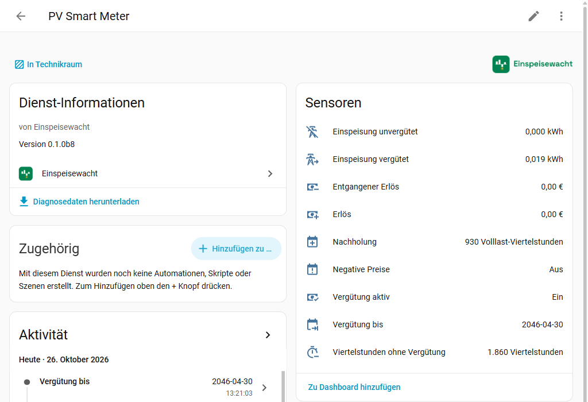
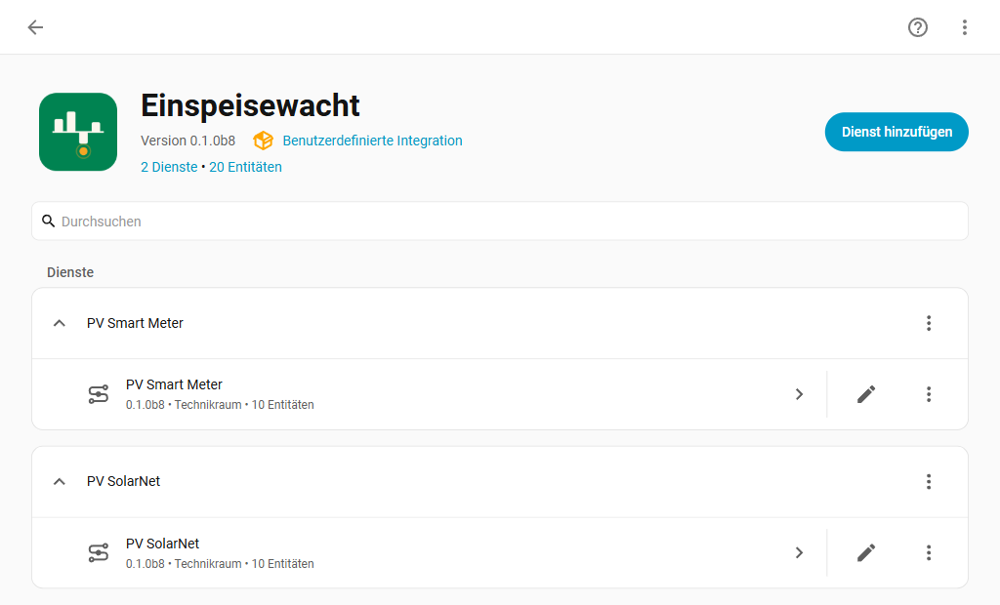
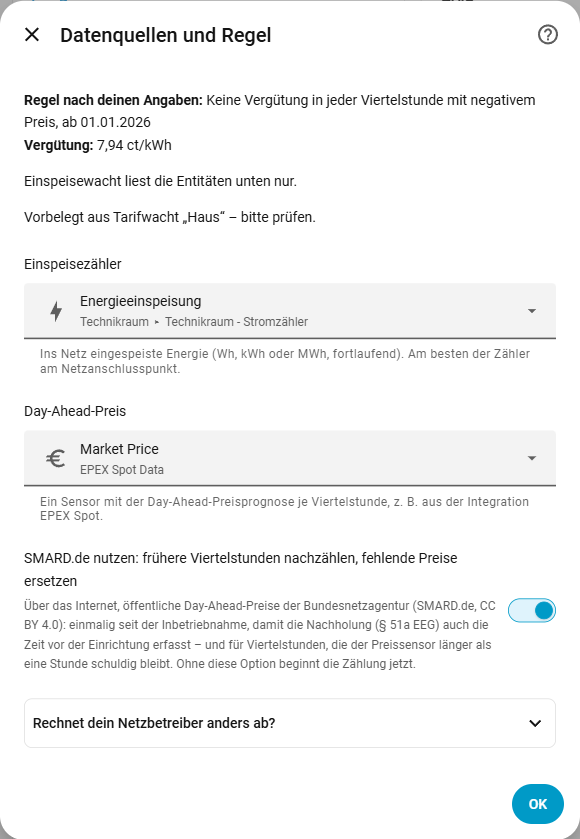
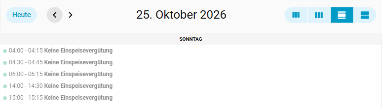
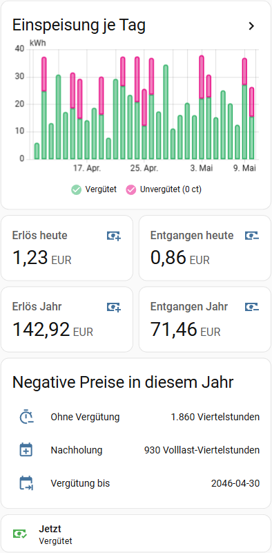

<picture>
  <source media="(prefers-color-scheme: dark)" srcset="https://raw.githubusercontent.com/einspeisewacht/integration/main/assets/github/readme-header-dark@2x.png">
  
</picture>

[](https://hacs.xyz/)
[](https://github.com/einspeisewacht/integration/releases)
[](https://github.com/einspeisewacht/integration/actions/workflows/ci.yml)
[](LICENSE)
[](https://einspeisewacht.github.io/integration/?lang=de)

🇩🇪 **Deutsch** · 🇬🇧 [English](https://github.com/einspeisewacht/integration/blob/main/README.en.md)

> ℹ️ **EEG-Novelle 2027:** Sie ist noch im Bundestag; was sich für bestehende Anlagen ändert, kommt mit einem Update.

**Wie viel deiner PV-Einspeisung wird wegen negativer Strompreise nicht vergütet?** Seit dem Solarspitzengesetz verlieren neue PV-Anlagen die Einspeisevergütung in jeder Viertelstunde mit negativem Börsenpreis. Einspeisewacht rechnet das in Home Assistant für dich mit: Viertelstunde für Viertelstunde, mit dem Preis genau dieser Viertelstunde – und zeigt, was dich das kostet und wie viel Förderzeit dafür am Ende angehängt wird.

**Ausprobieren ohne Installation:** Die [Demo](https://einspeisewacht.github.io/integration/?lang=de) zeigt Dashboard-Karte, Kalender, Hinweis am Vortag, Gerät und Bericht für eine Anlage mit und eine ohne Smart-Meter-Gateway – mit erfundenen Erträgen und Preisen, aber gerechnet vom Code der Integration.

> **Keine Rechts- oder Abrechnungsberatung.** Die Werte sind eine Orientierung. Maßgeblich ist die Abrechnung deines Netzbetreibers – er rechnet mit den Messwerten seines Zählers, Home Assistant meist mit Wechselrichter- oder Lesekopfwerten.

Die Oberfläche gibt es auf Deutsch und Englisch; sie folgt der Sprache deines Home Assistant.

## Inhalt

- [Was Einspeisewacht kann](#was-einspeisewacht-kann) · [Welche Regel gilt](#welche-regel-gilt--51-eeg) · [Was Einspeisewacht nicht kann](#was-einspeisewacht-nicht-kann)
- **Loslegen:** [Voraussetzungen](#voraussetzungen) · [Installation](#installation) · [Einrichtung](#einrichtung)
- **Nutzen:** [Entitäten](#entitäten) · [Bericht für einen Zeitraum](#bericht-für-einen-zeitraum) · [Statistik nachtragen](#statistik-nachtragen) · [Statistik neu berechnen](#statistik-neu-berechnen)
- **[Was du damit bauen kannst](#was-du-damit-bauen-kannst):** [Dashboard-Karte](#dashboard-karte-mit-tages--und-jahreswerten) · [Blueprint](#fertiger-blueprint) · [Speicher laden](#speicher-laden-solange-es-keine-vergütung-gibt-als-eigene-automation) · [Hinweis am Vortag](#hinweis-am-vortag)
- **Mehr:** [Datenschutz](#datenschutz) · [Fehlerbehebung](#fehlerbehebung) · [Entfernen](#entfernen) · [Fehler melden](#fehler-melden) · [Weitere Wachten](#weitere-wachten) · [Lizenz und Quellen](#lizenz-und-quellen)

## Was Einspeisewacht kann

- **Einspeisung vergütet / unvergütet** (kWh) und **Erlös / entgangener Erlös** (€) – mit Langzeitstatistik, also auch für Tag, Monat und Jahr.
- **Viertelstunden ohne Vergütung** im laufenden Jahr und die daraus folgende **Nachholung** nach § 51a EEG: Volllast-Viertelstunden und das Datum, bis zu dem deine Vergütung dann läuft.
- **Vergütung aktiv**: Binärsensor für Automationen – Speicher laden, Wallbox, Abregeln.
- **Kalender „Negative Preise“** mit den Zeitfenstern ohne Vergütung – heute und, sobald die Day-Ahead-Prognose da ist (meist ab etwa 13 Uhr), morgen.
- **Aktion „Bericht“** für einen frei wählbaren Zeitraum, je Monat aufgeschlüsselt – auch für die Zeit vor der Einrichtung, soweit die Statistik deines Zählers zurückreicht.
- Leitet die **geltende Regel** aus Inbetriebnahme, Leistung und Smart Meter ab – mit manueller Übersteuerung, falls dein Netzbetreiber anders abrechnet.
- **Genau an den Viertelstundengrenzen:** Jedes Zählerdelta wird zeitanteilig auf die Viertelstunden verteilt, jede mit ihrem eigenen Preis. Ein Preis von genau 0 gilt nicht als negativ.
- **Robust:** erkennt Zähler-Resets und unplausible Sprünge und bucht sie nicht; der Stand übersteht Neustarts; die Zeitumstellung (92 bzw. 100 Viertelstunden) ist berücksichtigt.



## Welche Regel gilt (§ 51 EEG)

| Inbetriebnahme | Installierte Leistung | Keine Vergütung, wenn … |
|---|---|---|
| ab 25.02.2025 | ab 100 kW | jede Viertelstunde mit negativem Day-Ahead-Preis |
| ab 25.02.2025 | 2 bis unter 100 kW | wie oben, aber erst ab dem 1. Januar des Jahres **nach** dem Einbau eines intelligenten Messsystems (iMSys) |
| ab 25.02.2025 | unter 2 kW | nicht betroffen |
| 2016 bis 24.02.2025 | ab 400 bzw. 500 kW | zusammenhängend negative Stunden – nicht umgesetzt (siehe unten) |
| sonst | | nicht betroffen |

Ein iMSys ist ein Smart Meter **Gateway** des Messstellenbetreibers; ein digitaler Zähler ohne Gateway zählt nicht. Greift die Regel für deine Anlage noch nicht, legt Einspeisewacht zusätzliche Sensoren an, die zeigen, was dann entgangen wäre.

**Feste Einspeisevergütung gibt es nur bis 100 kW** (§ 21 EEG). Größere Anlagen vermarkten direkt; bei negativen Preisen entfällt dort die Marktprämie, nicht ein fester Satz. Einspeisewacht zählt für sie Energie und Viertelstunden richtig, Erlös und entgangener Erlös sind dann nur ein grober Anhaltspunkt. Die Stunden-Regeln älterer Großanlagen betreffen deshalb nie eine Anlage mit fester Vergütung und sind nicht umgesetzt.

Fundstellen und Details: [docs/ENTWICKLUNG.md](docs/ENTWICKLUNG.md), Abschnitt 2.

## Voraussetzungen

- Home Assistant 2026.3 oder neuer.
- Ein **Einspeisezähler**: fortlaufender Energiesensor (Wh, kWh oder MWh, `state_class` `total` oder `total_increasing`) – am besten der Zähler am Netzanschlusspunkt, z. B. ein Smart Meter des Wechselrichterherstellers.
- Ein **Preissensor** mit Day-Ahead-Prognose je Viertelstunde, z. B. aus der Integration [EPEX Spot](https://github.com/mampfes/ha_epex_spot) (Quelle SMARD.de, Markt DE-LU). Getestet ist das Attribut `data` von EPEX Spot. Ohne Prognose-Attribut gilt der aktuelle Zustand als Preis der laufenden Viertelstunde – dann fehlen Preise für Zeiten, in denen Home Assistant aus war, und aktualisiert sich der Sensor erst einige Minuten nach der Viertelstundengrenze, gilt so lange noch der alte Wert.



## Installation

**Mit einem Klick:** [](https://my.home-assistant.io/redirect/hacs_repository/?owner=einspeisewacht&repository=integration&category=integration) → installieren, Home Assistant neu starten → [](https://my.home-assistant.io/redirect/config_flow_start/?domain=einspeisewacht)

Oder von Hand:

1. *Einstellungen → Marketplace → Durchstöbern*, nach Einspeisewacht suchen und installieren (vor Home Assistant 2026.11: in HACS suchen und herunterladen). Home Assistant neu starten.
2. *Einstellungen → Geräte & Dienste → Integration hinzufügen → Einspeisewacht*.

Hinweis: Im alten HACS-Dashboard (vor Home Assistant 2026.11) fehlt das Icon ([HACS-Issue #5171](https://github.com/hacs/integration/issues/5171)); im Marketplace und in den Einstellungen wird es angezeigt.

## Einrichtung

1. **Anlage:** Name, Inbetriebnahme, installierte Leistung (kWp), iMSys und Einbaudatum.
2. **Vergütung:** der Satz aus der Abrechnung deines Netzbetreibers in ct/kWh (nach Abzug der 0,4 ct) – einheitlich oder gestaffelt nach Leistungsstufen. Bei gestaffelter Vergütung bildet Einspeisewacht den Mischsatz nach § 23c EEG.
3. **Datenquellen:** Einspeisezähler und Preissensor. Hast du [Tarifwacht](https://github.com/tarifwacht/integration) eingerichtet, schlägt Einspeisewacht den Einspeisezähler und den Börsenpreis von dort vor.
4. **Regel:** zeigt die abgeleitete Regel, ab wann sie gilt, und den Vergütungssatz. Rechnet dein Netzbetreiber anders ab, kannst du sie übersteuern („jede negative Viertelstunde ab …“ oder „nicht betroffen“). Optional: **frühere negative Viertelstunden von SMARD.de nachzählen** – dann enthält die Nachholung auch die Zeit vor der Einrichtung, und fällt dein Preissensor aus, holt Einspeisewacht die fehlenden Preise ebenfalls von dort (öffentliche Preisdaten, siehe [Datenschutz](#datenschutz)).



Mehrere Anlagen oder Zähler: je einen Eintrag anlegen. Ändern: *Einspeisewacht → Eintrag → ⋮ → Neu konfigurieren*.

Was eine Änderung für die Zeit davor bedeutet:

- **Vergütungssatz** (auch Staffelung, Leistung, Voll-/Teileinspeisung): gilt rückwirkend ab der Einrichtung – Erlös und entgangener Erlös werden aus den gebuchten kWh neu berechnet. Die Langzeitstatistik vergangener Stunden (Statistik-Diagramme, Werte je Tag und Monat), auch [nachgetragene](#statistik-nachtragen), behält aber den alten Satz; Home Assistant bucht den ganzen Unterschied in die Stunde der Änderung. Unter *Reparaturen* erscheint deshalb der Hinweis „Statistik mit altem Satz“ – [Statistik neu berechnen](#statistik-neu-berechnen) bringt sie auf den neuen Satz.
- **Regel** (Inbetriebnahme, Leistung, Smart-Meter-Datum, Übersteuerung): Viertelstunden ohne Vergütung, Nachholung, „Vergütung bis“ und der [Bericht](#bericht-für-einen-zeitraum) folgen sofort der neuen Regel, auch rückwirkend. Die Summen „Einspeisung vergütet/unvergütet“, „Erlös“ und „Entgangener Erlös“ behalten für die Zeit vor der Änderung aber ihre Aufteilung: Eine sinkende kWh-Summe hielte Home Assistant für einen Zählerwechsel und verfälschte die Statistik. Die Werte nach neuer Regel liefert der Bericht. Betrifft die Änderung schon gebuchte negative Viertelstunden, erscheint unter *Einstellungen → Reparaturen* der Hinweis „Summen teils nach alter Regel“ mit dem Datum der Änderung und der Zahl der betroffenen Viertelstunden. Er verschwindet, wenn die Regel zurückgeändert wird, und lässt sich sonst ignorieren.
- **Einspeisezähler:** Der neue Zähler beginnt mit eigenem Ausgangswert; die Einspeisung zwischen dem letzten Wert des alten und dem ersten Wert des neuen Zählers wird nicht gebucht.

Benennst du Einspeisezähler oder Preissensor in Home Assistant um (neue Entity-ID), zieht Einspeisewacht das selbst nach – ohne Neu konfigurieren und ohne Verlust.

## Entitäten

| Entität | Typ | Bedeutung |
|---|---|---|
| Einspeisung vergütet | kWh | Netzeinspeisung in Viertelstunden mit Vergütung, seit Einrichtung |
| Einspeisung unvergütet | kWh | Netzeinspeisung in Viertelstunden ohne Vergütung |
| Erlös | € | vergütete Einspeisung × Satz |
| Entgangener Erlös | € | unvergütete Einspeisung × Satz |
| Viertelstunden ohne Vergütung | Anzahl | im laufenden Kalenderjahr, auch ohne Einspeisung (zählt für § 51a); Attribut `years` je Jahr |
| Nachholung | Volllast-Viertelstunden | Viertelstunden × 0,5, aufgerundet; Attribut `months` mit den Verlängerungsmonaten |
| Vergütung bis | Datum | Ende der Förderung einschließlich Nachholung |
| Vergütung aktiv | vergütet/unvergütet | ob die laufende Viertelstunde vergütet wird; unbekannt ohne Preis |
| Negative Preise | Kalender | Zeitfenster mit negativem Preis |
| Regel | Diagnose | die angewandte Regel, Attribute `applies_from` und `rate_ct_per_kwh` |
| Statistik neu berechnen | Schaltfläche (Konfiguration) | rechnet die Statistik von Erlös und entgangenem Erlös mit dem aktuellen Satz neu, siehe [Statistik neu berechnen](#statistik-neu-berechnen) |
| Bericht für Fehlermeldung | Schaltfläche (Diagnose) | zeigt einen kurzen Bericht zum Kopieren in ein Issue, siehe [Fehler melden](#fehler-melden) |

Solange die Regel noch nicht greift (z. B. ohne iMSys), kommen „Unvergütet bei greifender Regel“, „Entgangener Erlös bei greifender Regel“ und „Viertelstunden ohne Vergütung bei greifender Regel“ dazu; Nachholung und „Vergütung bis“ entfallen dann.

Tages-, Monats- und Jahreswerte: Die Summen-Sensoren haben Langzeitstatistik – z. B. mit der Statistik-Karte (Zeitraum „Monat“, Statistik „Änderung“); eine fertige Karte steht unter [Dashboard-Karte](#dashboard-karte-mit-tages--und-jahreswerten).

## Bericht für einen Zeitraum

*Entwicklerwerkzeuge → Aktionen →* **Einspeisewacht: Bericht**, Anlage und Zeitraum wählen, „Antwort anzeigen“:

```yaml
action: einspeisewacht.report
data:
  config_entry_id: <Eintrag auswählen>
  start: "2026-01-01"
  end: "2026-12-31"
```

Beispielantwort (gekürzt, Werte erfunden):

```yaml
plant: Dach
rule: quarter_hour
rate_ct_per_kwh: 7.94
energy_paid_kwh: 1800.0
energy_unpaid_kwh: 900.0
revenue_eur: 142.92
revenue_lost_eur: 71.46
negative_quarter_hours: 1860
months:
  - month: 2026-04
    energy_paid_kwh: 120.0
    energy_unpaid_kwh: 210.0
    ...
gaps:
  quarter_hours_without_price: 0
```

Die Antwort enthält kWh vergütet und unvergütet, Erlös, entgangenen Erlös und die negativen Viertelstunden – gesamt und je Monat. Grundlage ist die Langzeitstatistik deines Einspeisezählers (Stundenwerte, gleichmäßig auf die vier Viertelstunden verteilt – exakt, wenn alle vier gleich ausgehen, sonst eine gute Näherung). Viertelstunden ohne bekannten Preis zählen als vergütet und stehen unter `gaps` – auch die Zeit, in der Home Assistant länger als 14 Tage aus war; mit der SMARD-Option reichen die Preise bis zur Inbetriebnahme zurück.

**Unplausible Stunden** in der Statistik des Zählers bleiben außen vor und stehen unter `gaps.hours_implausible` (Anzahl und die ersten fünf Stunden): eine Stunde mit mehr Einspeisung als Anlagenleistung × 1,5 – dieselbe Grenze wie für jede Ablesung im laufenden Betrieb, bei 9 kWp also 13,5 kWh; nach einer Pause von Home Assistant entsprechend mehr –, eine negative Stunde (Zähler getauscht, Statistik korrigiert) und die Stunde danach, in der der Zählerstand nach so einem Sprung wieder fällt. Typischer Fall: Ein Zähler meldet kurz Wh als kWh (107 → 109.851 → 110 kWh); ohne die Prüfung käme so ein Tag auf über 100.000 kWh. Diese Stunden zählen auch unter `hours_without_energy`.

## Statistik nachtragen

Die Summen-Sensoren beginnen mit der Einrichtung. Damit Statistik-Karten und Verlauf auch die Zeit davor zeigen, gibt es die Aktion **Einspeisewacht: Statistik nachtragen** (*Entwicklerwerkzeuge → Aktionen*), z. B. ab dem 1. Januar oder ab der Inbetriebnahme:

```yaml
action: einspeisewacht.import_statistics
data:
  config_entry_id: <Eintrag auswählen>
  start: "2026-01-01"
```

Sie rechnet wie der Bericht (Stundenwerte des Zählers gegen die negativen Viertelstunden) und schreibt die Stunden **vor** dem ersten vorhandenen Statistikwert in die Langzeitstatistik von „Einspeisung vergütet/unvergütet“, „Erlös“ und „Entgangener Erlös“; die späteren Summen werden passend verschoben. Voraussetzungen: die SMARD-Option ist an und ihr Abruf fertig (sonst fehlen Preise), und die Sensoren haben schon mindestens eine Stunde Statistik. [Unplausible Stunden](#bericht-für-einen-zeitraum) des Zählers werden nicht nachgetragen und stehen in der Antwort unter `hours_implausible`. **Das greift in die Statistik-Datenbank ein – vorher ein Backup anlegen.** Ein zweiter Aufruf findet nichts mehr nachzutragen.

## Statistik neu berechnen

Korrigierst du den Vergütungssatz (unter *Neu konfigurieren*; auch Staffelung, Leistung oder Voll-/Teileinspeisung, wenn sie den Satz ändern), zeigen Erlös und entgangener Erlös sofort die neuen Summen. Die Langzeitstatistik vergangener Stunden, aus der Statistik-Diagramme, Werte je Tag und Monat und die [Dashboard-Karte](#dashboard-karte-mit-tages--und-jahreswerten) kommen, behält dagegen den alten Satz, auch nachgetragene; den ganzen Unterschied bucht Home Assistant in die Stunde der Änderung. Unter *Reparaturen* erinnert der Hinweis „Statistik mit altem Satz“ daran. Dafür gibt es am Gerät der Anlage die Schaltfläche **Statistik neu berechnen** (unter *Konfiguration*):

- Sie berechnet die Statistik von Erlös, entgangenem Erlös und – solange die Regel noch nicht greift – „Entgangener Erlös bei greifender Regel“ von deren erstem Wert bis zum letzten mit dem aktuellen Satz neu: aus der Statistik der Energie-Sensoren, also exakt aus dem, was je Stunde gebucht ist. Die Statistik danach schließt ohne Sprung an.
- Geschrieben werden nur Zeilen, deren Wert sich ändert; Sensoren ohne Änderung bleiben unberührt. Das schont die SD-Karte eines Raspberry Pi.
- Das Ergebnis erscheint als Benachrichtigung: Zeitraum, Satz, wie viele Zeilen geschrieben wurden und um wie viel sich die Summe jedes Sensors geändert hat. Der Reparaturhinweis verschwindet danach (oder wenn du den Satz zurückänderst).
- Zweimal drücken ergibt dasselbe und schreibt beim zweiten Mal nichts. Sensoren ohne Statistik bleiben, wie sie sind.
- Auch die Fünf-Minuten-Statistik der letzten 10 Tage wird neu berechnet; ältere (bei längerem `purge_keep_days`) bleibt, die zeigen nur Fünf-Minuten-Diagramme.
- Ab einem bestimmten Tag: die Aktion **Statistik nachtragen** mit **Vorhandene Statistik ersetzen** (`replace: true`). Davor bleibt die Statistik unverändert; liegt der Tag vor der Einrichtung, wird die Zeit davor zuerst nachgetragen.
- Nicht neu berechnet wird die Aufteilung vergütet/unvergütet nach einer Regeländerung (siehe [Einrichtung](#einrichtung)): Die Summen-Sensoren behalten sie bewusst, die Statistik folgt ihnen.
- **Auch das greift in die Statistik-Datenbank ein – vorher ein Backup anlegen.**

## Was du damit bauen kannst

Der Kalender „Negative Preise“ zeigt die Zeitfenster ohne Vergütung – hier der Tag der Zeitumstellung 2026:



### Dashboard-Karte mit Tages- und Jahreswerten

Die Summen-Sensoren zählen ab der Einrichtung; Tages-, Monats- und Jahreswerte kommen aus ihrer Langzeitstatistik – nach [Statistik nachtragen](#statistik-nachtragen) auch für die Zeit davor. Diese Karte nutzt nur Bordmittel (Werte erfunden):



<details>
<summary>YAML der Karte (Entitäten der Anlage „Dach“ anpassen)</summary>

```yaml
type: vertical-stack
cards:
  - type: statistics-graph
    title: Einspeisung je Tag
    entities:
      - entity: sensor.dach_einspeisung_vergutet
        name: Vergütet
        color: "#27ae60"
      - entity: sensor.dach_einspeisung_unvergutet
        name: Unvergütet (0 ct)
        color: "#e6007e"
    period: day
    days_to_show: 30
    chart_type: bar-stack
    stat_types:
      - change
  - type: grid
    columns: 2
    square: false
    cards:
      - type: statistic
        entity: sensor.dach_erlos
        name: Erlös heute
        stat_type: change
        period:
          calendar:
            period: day
      - type: statistic
        entity: sensor.dach_entgangener_erlos
        name: Entgangen heute
        stat_type: change
        period:
          calendar:
            period: day
      - type: statistic
        entity: sensor.dach_erlos
        name: Erlös Jahr
        stat_type: change
        period:
          calendar:
            period: year
      - type: statistic
        entity: sensor.dach_entgangener_erlos
        name: Entgangen Jahr
        stat_type: change
        period:
          calendar:
            period: year
  - type: entities
    title: Negative Preise in diesem Jahr
    entities:
      - entity: sensor.dach_viertelstunden_ohne_vergutung
        name: Ohne Vergütung
      - entity: sensor.dach_nachholung
        name: Nachholung
      - entity: sensor.dach_vergutung_bis
        name: Vergütung bis
  - type: tile
    entity: binary_sensor.dach_vergutung_aktiv
    name: Jetzt
```

</details>

### Fertiger Blueprint

| Blueprint | Was er tut | |
|---|---|---|
| **Bei negativem Preis umschalten** | führt eigene Aktionen aus, sobald die Vergütung entfällt (z. B. Speicher laden, Wallbox an, abregeln), und andere, sobald sie wieder gezahlt wird | [](https://my.home-assistant.io/redirect/blueprint_import/?blueprint_url=https%3A%2F%2Fgithub.com%2Feinspeisewacht%2Fintegration%2Fblob%2Fmain%2Fblueprints%2Fautomation%2Feinspeisewacht%2Fvergutung_aus_an.yaml) |

### Speicher laden, solange es keine Vergütung gibt (als eigene Automation)

```yaml
alias: Speicher bei negativem Preis laden
triggers:
  - trigger: state
    entity_id: binary_sensor.dach_vergutung_aktiv
    to: "off"
actions:
  - action: select.select_option
    target:
      entity_id: select.wechselrichter_speichermodus   # deine Entität
    data:
      option: "Laden aus PV"
mode: single
```

### Hinweis am Vortag

```yaml
alias: Morgen gibt es Viertelstunden ohne Vergütung
triggers:
  - trigger: calendar
    event: start
    offset: "-12:00:00"
    entity_id: calendar.dach_negative_preise
conditions:
  - condition: template
    value_template: "{{ trigger.calendar_event.summary == 'Keine Einspeisevergütung' }}"
actions:
  - action: notify.mobile_app_mein_handy   # dein Gerät
    data:
      title: Negative Strompreise
      message: >-
        {{ as_timestamp(trigger.calendar_event.start) | timestamp_custom('%H:%M') }}–{{
        as_timestamp(trigger.calendar_event.end) | timestamp_custom('%H:%M') }} Uhr ohne Vergütung.
mode: queued
```

Die Entitäts-IDs hängen vom Namen deiner Anlage ab (hier „Dach“).

## Datenschutz

Einspeisewacht rechnet lokal und liest nur die Entitäten, die du auswählst. Einzige Ausnahme, nur wenn du sie einschaltest: Die SMARD-Option lädt öffentliche Day-Ahead-Preise von smard.de (Bundesnetzagentur) – einmalig für die Zeit vor der Einrichtung und danach nur, wenn dein Preissensor länger als eine Stunde keine Preise liefert (höchstens einmal je Stunde). Dabei wird nichts über dich oder deine Anlage übertragen – nur der Abruf der Preisdateien mit der Kennung `Einspeisewacht/<Version>`. Die Diagnose-Datei enthält weder den Anlagennamen noch Zählerstände, Energie- oder Erlössummen; der [Bericht für Fehlermeldung](#fehler-melden) auch nicht, dazu keine Entity-IDs.

## Was Einspeisewacht nicht kann

- **Keine Abrechnung:** Abweichungen zur Abrechnung des Netzbetreibers sind normal (andere Messung, Rundung).
- **Keine Direktvermarktung:** Marktprämie und Ausfallvergütung bildet Einspeisewacht nicht ab (siehe oben, über 100 kW).
- **Keine Altregeln** für Großanlagen (Stunden-Blöcke 2016 bis 24.02.2025).
- **Freiwilliger Wechsel ins neue Regime** (§ 100 Abs. 47 EEG, +0,6 ct/kWh) wird nicht angeboten, solange die beihilferechtliche Genehmigung der EU fehlt.
- **Der Zähler muss die Netzeinspeisung messen.** Ein Erzeugungszähler (PV-Ertrag) zählt auch Eigenverbrauch und Speicherladung mit – die sind von der Regel nicht betroffen.
- Die Summen-Sensoren beginnen bei der Einrichtung; für die Zeit davor gibt es die Aktionen „Bericht“ und „Statistik nachtragen“.

## Fehlerbehebung

- **Werte bleiben bei 0:** Prüfe, ob der Einspeisezähler Werte liefert und ob die Regel schon greift (Sensor „Regel“, Attribut `applies_from`).
- **„Vergütung aktiv“ ist unbekannt:** Der Preissensor liefert für die laufende Viertelstunde keinen Preis.
- **Hinweis „Einspeisezähler fehlt“ unter Reparaturen:** Die Zähler-Entität gibt es nicht mehr (gelöscht oder umbenannt, während Einspeisewacht nicht geladen war). Bis sie wieder da ist, bucht Einspeisewacht nichts. Unter *Neu konfigurieren* den richtigen Zähler wählen; die bisherigen Summen bleiben erhalten. Der gewählte Zähler beginnt dann wie bei einem Zählertausch mit eigenem Ausgangswert: Einspeisung aus der Zeit, in der der alte Zähler fehlte, wird nicht gebucht.
- **Hinweis „Sensor von Einspeisewacht als Quelle“ unter Reparaturen:** Der Eintrag nutzt einen Sensor von Einspeisewacht selbst (seine eigenen Summen oder die einer anderen Anlage) als Einspeisezähler oder Preissensor – das ließ das Formular früher zu. Einspeisewacht liest ihn nicht: Ohne Zähler wird nichts gebucht, ohne Preis gilt die Einspeisung nach 24 Stunden als vergütet (mit der SMARD-Option: Preise von SMARD.de). Unter *Einspeisewacht → ⋮ → Neu konfigurieren* den echten Zähler bzw. Preissensor wählen; schon Gebuchtes bleibt.
- **Hinweis „SMARD.de nicht erreichbar“ unter Reparaturen:** Der Abruf früherer Preise ist fehlgeschlagen; beim nächsten Start von Home Assistant wird es erneut versucht. Die laufende Buchung ist nicht betroffen.
- **Bericht für Fehlermeldung:** Schaltfläche am Gerät unter *Diagnose*, siehe [Fehler melden](#fehler-melden). **Diagnose:** *Einspeisewacht → Eintrag → ⋮ → Diagnose herunterladen*. **Debug-Protokoll:** *Einspeisewacht → ⋮ → Debug-Protokollierung aktivieren*.

## Entfernen

1. *Einstellungen → Geräte & Dienste → Einspeisewacht* → bei jedem Eintrag ⋮ → *Löschen*. Die gespeicherten Buchungen dieses Eintrags werden mit gelöscht.
2. Optional: *Einstellungen → Marketplace → Installiert* → Einspeisewacht → ⋮ → *Deinstallieren* (vor Home Assistant 2026.11: HACS → Einspeisewacht → ⋮ → *Entfernen*), dann Home Assistant neu starten.

Die Langzeitstatistik der gelöschten Sensoren bleibt in Home Assistant erhalten, bis du sie unter *Entwicklerwerkzeuge → Statistik* entfernst.

## Fehler melden

Bitte als [Issue](https://github.com/einspeisewacht/integration/issues), mit dem **Bericht für Fehlermeldung**: *Einspeisewacht → Eintrag → Gerät → Diagnose → Bericht für Fehlermeldung* drücken. Der Bericht erscheint als Benachrichtigung (Glocke unten links) zum Kopieren. Er enthält die Versionen, Regel und Beginn, den Vergütungssatz, den Stand von Preisen, Zähler und Buchung (Zeitpunkte und Anzahlen), die Zuordnung nach Rolle (Integration, Einheit, Zustandsklasse, Zustand – beim Zähler ohne Zählerstand), die Einstellungen (Inbetriebnahme und Smart-Meter-Datum nur mit Monat), welche Sensoren unbekannt sind und warum, und offene Reparaturhinweise. Entity-IDs, der Name der Anlage und Bereiche stehen nicht darin. Lies ihn trotzdem vor dem Teilen und lösche, was du nicht zeigen willst. Sicherheitslücken bitte vertraulich, siehe [SECURITY.md](SECURITY.md).

### Was steht in der Diagnose-Datei?

Reicht der Bericht nicht, kommt im Issue die Bitte um die Diagnose-Datei (*⋮ → Diagnose herunterladen*). Sie ist ausführlicher, und nicht alles darin kommt von Einspeisewacht:

- **Von Home Assistant** (jede Integration hat diesen Kopf, Einspeisewacht kann ihn nicht ändern): Version und Installationsart, Betriebssystem, Zeitzone und unter `custom_components` die Liste **aller** installierten benutzerdefinierten Integrationen mit Versionen. Diese Blöcke darfst du vor dem Hochladen löschen, sie werden nicht gebraucht.
- **Von Einspeisewacht** (unter `data`): die Einstellungen ohne den Namen der Anlage – also mit den Entity-IDs von Einspeisezähler und Preissensor, Inbetriebnahme- und Smart-Meter-Datum auf den Tag, Leistung und Vergütungssatz –, die Regel, der Stand von Preisen, Zähler und Buchung, die Zahl negativer Viertelstunden je Jahr, Lücken und der SMARD-Abruf. Zählerstände, Energie- und Erlössummen stehen nicht darin.

Willst du die Datei nicht öffentlich teilen, ist das in Ordnung: Dann reichen meist der Bericht und gezielte Angaben, nach denen im Issue gefragt wird.

Pull Requests sind willkommen. Wie, steht in [CONTRIBUTING.md](CONTRIBUTING.md).

## Weitere Wachten

Vom selben Autor und nach demselben Muster gebaut: Einrichtung über die Oberfläche, deutsch und englisch, schonend für SD-Karten.

- **Energie**
  - [Tarifwacht](https://github.com/tarifwacht/integration) – was der eigene Strombezug mit anderen Tarifen gekostet hätte, auch dynamisch und mit Modul 3 · [Demo](https://tarifwacht.github.io/integration/?lang=de)
  - [Speicherwacht](https://github.com/speicherwacht/integration) – Wirkungsgrad, Zyklen und Kapazität des Batteriespeichers · [Demo](https://speicherwacht.github.io/integration/?lang=de)
  - [Wärmewacht](https://github.com/waermewacht/integration) – Arbeitszahlen und Gesundheits-Check der Wärmepumpe · [Demo](https://waermewacht.github.io/integration/?lang=de)
- **Alltag**
  - [Eilwacht](https://github.com/eilwacht/integration) – Tagesschau-Eilmeldungen und Regionalnachrichten als Auslöser für Automationen · [Demo](https://eilwacht.github.io/integration/?lang=de)
  - [Streckenwacht](https://github.com/streckenwacht/integration) – Baustellen, Sperrungen und Staus auf den eigenen Strecken · [Demo](https://streckenwacht.github.io/integration/?lang=de)

## Lizenz und Quellen

MIT. Historische Day-Ahead-Preise (optional): Bundesnetzagentur | [SMARD.de](https://www.smard.de), [CC BY 4.0](https://creativecommons.org/licenses/by/4.0/); Einspeisewacht zählt daraus nur die negativen Viertelstunden.
